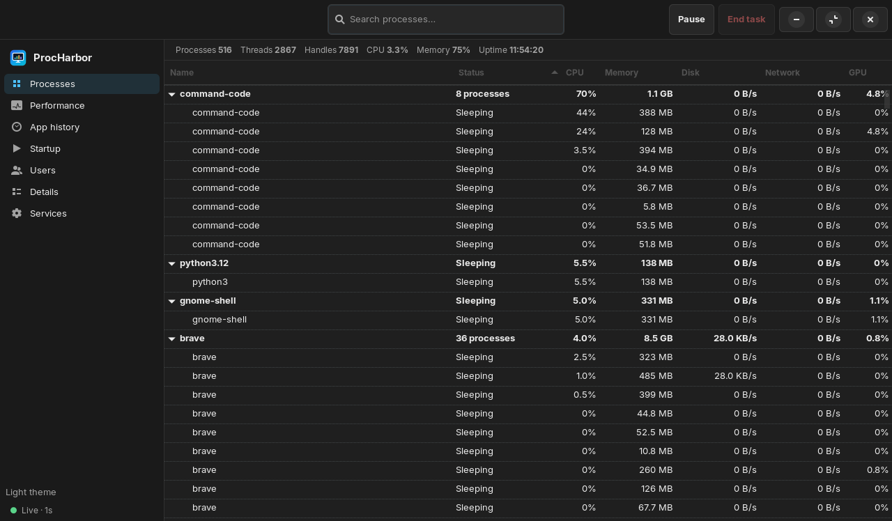

<p align="center">
  
</p>

<h1 align="center">ProcHarbor</h1>

<p align="center">A lightweight native Linux task manager and system monitor written in Rust.</p>

<p align="center">
  <a href="https://shripad-jyothinath.github.io/procharbor/">Website</a> ·
  <a href="https://github.com/shripad-jyothinath/procharbor/releases">Releases</a> ·
  <a href="https://github.com/shripad-jyothinath/procharbor">Source</a>
</p>

ProcHarbor is an independent Linux desktop task manager written in Rust with
`eframe`/`egui`. It covers the tabs people expect from a task manager — processes,
performance, startup apps, users, details and services — using `/proc`, `/sys`,
systemd and DRM fdinfo directly. No root, no daemon, no network access, and no
Python runtime overhead.



## Features

- **Processes** — split into **Apps**, **Background** and **System**
  sections, grouped by executable with application icons, groups collapsed by
  default, CPU and memory load colouring, sortable columns, search,
  per-process CPU, memory, disk, network and GPU, End task and force kill.
- **Performance** — CPU (per-core clocks and charts, package temperature),
  Memory, Disk (volumes, NVMe temperature), Wi-Fi (signal, link rate, adapter,
  power save) and GPU, all with live charts.
- **App history** — cumulative CPU time, network and disk totals per app.
- **Startup** — user autostart entries plus enabled systemd user services
  (including `warp-taskbar.service`), with status and type.
- **Users** — login sessions with per-user CPU, memory, disk, network and
  process counts.
- **Details** — flat process table: PID, status, user, CPU, memory, disk,
  network, GPU, threads, handles, priority and command line.
- **Services** — systemd units with main PID, state, startup type and scope.
- Search, column sorting, pause, end task or force kill, light/dark theme and `Ctrl+F`.

## Install

### Via Python / PyPI

Install the native executable as a Python package via `pip` or `pipx`:

```sh
# Using pipx (recommended for standalone CLI / GUI tools)
pipx install procharbor

# Or using pip
pip install procharbor
```

Then run `procharbor` from your terminal or desktop menu.

### Via Flatpak

ProcHarbor can be built and run as a sandboxed Flatpak:

```sh
# Build Flatpak bundle locally
./build-flatpak.sh

# Install bundle
flatpak install --user dist/procharbor.flatpak
```

### Via APT Repository (Recommended)

Install and receive automatic updates through `apt`:

```sh
curl -fsSL https://shripad-jyothinath.github.io/procharbor/install-repo.sh | sudo bash
sudo apt install procharbor
```

Or configure manually with verified GPG signature:

```sh
# Add repository signing key
sudo mkdir -p /etc/apt/keyrings
curl -fsSL https://shripad-jyothinath.github.io/procharbor/procharbor-archive-keyring.gpg | sudo tee /etc/apt/keyrings/procharbor.gpg > /dev/null

# Add repository source
echo "deb [arch=$(dpkg --print-architecture) signed-by=/etc/apt/keyrings/procharbor.gpg] https://shripad-jyothinath.github.io/procharbor/debian stable main" | sudo tee /etc/apt/sources.list.d/procharbor.list

# Update and install
sudo apt update
sudo apt install procharbor
```

### Direct Debian package

Download the `.deb` for your architecture from
[Releases](https://github.com/shripad-jyothinath/procharbor/releases):

```sh
# x86_64
sudo apt install ./procharbor_1.3.0_amd64.deb

# arm64
sudo apt install ./procharbor_1.3.0_arm64.deb
```

Launch **ProcHarbor** from the application menu, or run:

```sh
procharbor
```

### From source

Requires a Rust toolchain (`rustc` / `cargo`):

```sh
./run.sh
```

Or run directly with Cargo:

```sh
cargo run --release
```

Install a menu entry and desktop shortcut for the source checkout:

```sh
./install-shortcut.sh
```

## Build the Debian package

```sh
./build-deb.sh
```

This builds the native release binary and creates `dist/procharbor_1.3.0_<arch>.deb`
and `dist/SHA256SUMS`.

Build requirements: Rust (`cargo`), `dpkg-deb`.

## Linux mappings

- **Handles** are open file descriptors.
- **Paged pool** maps to Slab; **non-paged pool** to kernel stack + page tables.
- **Disk per process** comes from `/proc/<pid>/io`; other users' processes are
  unreadable and show 0.
- **Network per process** is attributed from `ss -tunpi`, so it covers processes
  you own and is sampled every 4 seconds.
- **GPU utilization** comes from DRM `drm-engine-*` counters in
  `/proc/<pid>/fdinfo`, sampled every 6 seconds. Integrated GPUs report
  "Shared" memory.
- **Startup impact** cannot be measured on Linux; the tab shows user-added
  autostart entries with their enabled/disabled status.
- **RAM hardware specifications** (Memory Type e.g. LPDDR5/DDR4/DDR5, speed, manufacturer e.g. Micron/Kingston/Samsung, form factor, slots used, and hardware reserved memory) are detected without root privileges using the udev DMI database (`/run/udev/data/+dmi:id`) and EDAC (`/sys/devices/system/edac/mc/`), falling back to `dmidecode` if available.

## Performance

Compiled to a single native Rust binary using GPU-accelerated `eframe` (`glow`)
rendering and direct `/proc` / `/sys` parsing without interpreter overhead.

## License

MIT. ProcHarbor is not affiliated with Microsoft or the Windows Task Manager.
